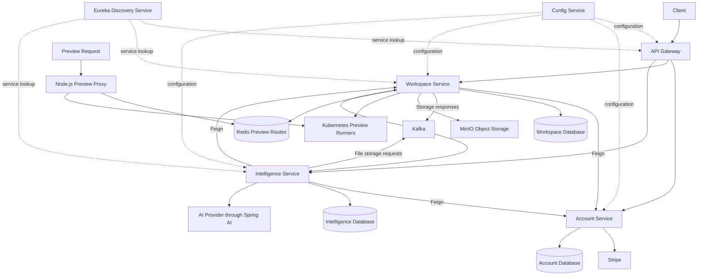

# Omega

Omega is a Java microservices backend for an AI-assisted application builder. Users can create projects, manage collaborators, generate code through a streaming chat interface, and launch project previews on Kubernetes.

The backend uses Spring Boot, Spring Cloud, Spring AI, Kafka, PostgreSQL, MinIO and Redis. Stripe handles subscription checkout and billing events.

## Architecture



### Services

| Module | Responsibility | Data and integrations |
| --- | --- | --- |
| `account-service` | Signup, login, user profiles, subscription plans and billing | PostgreSQL, Stripe |
| `workspace-service` | Projects, project members, file access and preview deployment | PostgreSQL, MinIO, Redis, Kubernetes, Account Service |
| `intelligence-service` | Streaming AI chat, project context, generated file events and token usage records | PostgreSQL, Spring AI, Kafka, Workspace Service, Account Service |
| `api-gateway` | API routing, JWT validation and CORS configuration | Spring Cloud Gateway, external configuration |
| `config-service` | Centralized service configuration from a Git repository | Spring Cloud Config Server |
| `discovery-service` | Service registration and discovery | Eureka |
| `common-lib` | Shared DTOs, events, JWT authentication, Feign token forwarding and error handling | Shared Java library installed before dependent services |

Each business service owns its persistence model. Cross-service Feign calls exchange DTOs, and the shared library supplies authentication and event contracts.

### Code generation and file storage

1. The client submits a project message to the Intelligence Service through the gateway.
2. The service gathers the project's file tree and requested file contents through Workspace Service APIs.
3. Spring AI streams the model response as server-sent events. The backend records chat messages, usage and parsed generation events.
4. Generated file changes are published to Kafka on `file-storage-request-event`, carrying a saga identifier.
5. Workspace Service saves file content and metadata, records processed saga identifiers, and publishes acknowledgements on `file-store-responses`.
6. Intelligence Service handles the acknowledgements to confirm successful file events or remove failed events.

### Project previews

Workspace Service reuses an active project runner or claims an idle runner from the Kubernetes pool. A MinIO sync container copies project files into the shared workspace and watches for updates. The Node.js runner starts the generated application on port 5173.

The service registers the project's hostname in Redis. The preview proxy resolves that hostname to a runner and forwards HTTP and WebSocket traffic. The manifests use `omega-core` for application infrastructure and `omega-previews` for preview workloads.

## Technology

| Area | Technology |
| --- | --- |
| Language and build | Java 21, Maven Wrapper |
| Application framework | Spring Boot 4.0.3 |
| Service configuration and discovery | Spring Cloud 2025.1.0, Config Server, Eureka |
| AI integration | Spring AI 2.0.0-M2, OpenAI model integration |
| Persistence and messaging | Spring Data JPA, PostgreSQL, Kafka |
| Storage and preview routing | MinIO, Redis |
| Authentication | Spring Security, JWT, BCrypt |
| Billing | Stripe |
| Deployment | Kubernetes, Fabric8 client, Jib, Docker Compose, GitHub Actions |

## Project layout

```text
Omega/
├── account-service/
├── api-gateway/
├── common-lib/
├── config-service/
├── discovery-service/
├── intelligence-service/
├── workspace-service/
├── k8s/
│   ├── infra/
│   ├── proxy/
│   ├── services/
│   └── stateful/
├── .github/workflows/
├── compose.yaml
└── ENVIRONMENT.md
```

The Maven groupId is `com.omega`. Java sources follow `src/main/java/com/omega/<module_package>/`, with test sources under `src/test/java/`. Module packages use snake_case, such as `account_service` and `common_lib`.

## Local setup

### Prerequisites

- JDK 21 and Git.
- A Git configuration repository containing the service runtime configuration.
- Reachable PostgreSQL databases, Kafka, Redis and MinIO.
- Your AI provider and Stripe credentials for the corresponding features.
- Docker for Compose, or a Kubernetes cluster and appropriate access for project previews.

Supply runtime values through shell environment variables, IntelliJ run configurations or Kubernetes Secrets. Configuration includes database connections, shared JWT signing material, service routes, storage settings and provider credentials. The config server reads its repository URL from `CONFIG_GIT_URI` and its branch from `CONFIG_GIT_LABEL`, which defaults to `main`.

The complete variable list, sources and IntelliJ instructions are in [ENVIRONMENT.md](ENVIRONMENT.md).

### Build

Run these PowerShell commands from the repository root. Each module has its own Maven Wrapper and POM.

```powershell
.\common-lib\mvnw.cmd -B -ntp -f common-lib/pom.xml clean install

$services = @(
    'account-service', 'api-gateway', 'config-service',
    'discovery-service', 'intelligence-service', 'workspace-service'
)

foreach ($service in $services) {
    & ".\$service\mvnw.cmd" -B -ntp -f "$service/pom.xml" clean package -DskipTests '-Djib.skip=true'
    if ($LASTEXITCODE -ne 0) { throw "Build failed for $service" }
}
```

On Linux or macOS, use each module's `./mvnw` wrapper. The packaging command skips context tests and the existing Jib image-publication step. Run tests separately once the runtime infrastructure is available.

### Run

1. Configure the external configuration repository and provision the databases, broker and storage services.
2. Start `config-service` on port 8888 and `discovery-service` on port 8761.
3. Start Account, Workspace and Intelligence services with their required environment values.
4. Start API Gateway and connect the client to its configured routes.

For IntelliJ, import all seven POMs as Maven projects and select JDK 21. Set environment variables in each application's run configuration.

After packaging the service jars, Compose can start the Java processes using variables exported in your shell.

```powershell
docker compose config --quiet
docker compose up
```

Configure infrastructure addresses that are reachable from the containers. Service ports and context paths come from the external configuration repository and must match the Compose or Kubernetes configuration.

## API overview

These are controller paths. Gateway routing and configured service context paths determine the client-facing URLs.

| Area | Representative endpoints |
| --- | --- |
| Authentication | `POST /auth/signup`, `POST /auth/login` |
| Projects | `GET /projects`, `POST /projects`, `GET /projects/{id}`, `PATCH /projects/{id}`, `DELETE /projects/{id}` |
| Collaboration | `GET /projects/{projectId}/members`, `POST /projects/{projectId}/members` |
| Files | `GET /projects/{projectId}/files`, `GET /projects/{projectId}/files/content` |
| Preview deployment | `POST /projects/{id}/deploy` |
| AI chat | `POST /chat/stream`, `GET /chat/projects/{projectId}` |
| Billing | `GET /api/me/subscription`, `POST /api/payments/checkout`, `POST /api/payments/portal` |
| Payment events | `POST /webhooks/payment` |

JWT bearer tokens authenticate requests, and shared Feign configuration forwards the caller's token to downstream services. Workspace authorization checks project membership and permissions. Internal user, plan and file APIs support service-to-service calls.

## Kubernetes and CI/CD

The Kubernetes manifests cover application services, PostgreSQL, Kafka, Redis, MinIO, network policies, preview runners, ingress and the preview proxy. Supply your registry namespace, image tags, owned hostnames and runtime secrets before deployment. Render `${VARIABLE}` manifest placeholders before applying the files.

The three GitHub Actions workflows cover Account Service, API Gateway and Config Service. Changes to a service, `common-lib` or its workflow trigger a build on `main`. Each workflow installs `common-lib` before packaging its service.

Image publication and GKE deployment are available through a manual workflow run with `deploy` enabled. Deployment validates the required settings, tags images with the Git commit SHA, authenticates to Google Cloud through workload identity federation, and performs a Kubernetes image update followed by a rollout-status check.

Set repository variable `IMAGE_NAMESPACE` to your lowercase Docker Hub namespace and provide the following repository secrets from your own accounts.

- `DOCKERHUB_USERNAME` and `DOCKERHUB_TOKEN`
- `GCP_WORKLOAD_IDENTITY_PROVIDER` and `GCP_SERVICE_ACCOUNT`
- `GCP_CLUSTER` and `GCP_ZONE`

## Tests and current verification

Run a service's existing tests with its Maven Wrapper, for example `./mvnw test` from the service directory. Context tests load the Spring application and require its runtime configuration and infrastructure.

The latest local verification passed clean packaging for all seven modules. Config Service and Discovery Service context tests passed. Account, Gateway, Intelligence and Workspace context tests failed because the config server at `localhost:8888` was unavailable. `common-lib` currently has no test sources. Compose configuration and workflow lint checks passed.

The AI usage service contains daily quota-checking logic, while its invocation in the generation flow is currently commented out. Full runtime and deployment verification requires your configured infrastructure and provider credentials.
